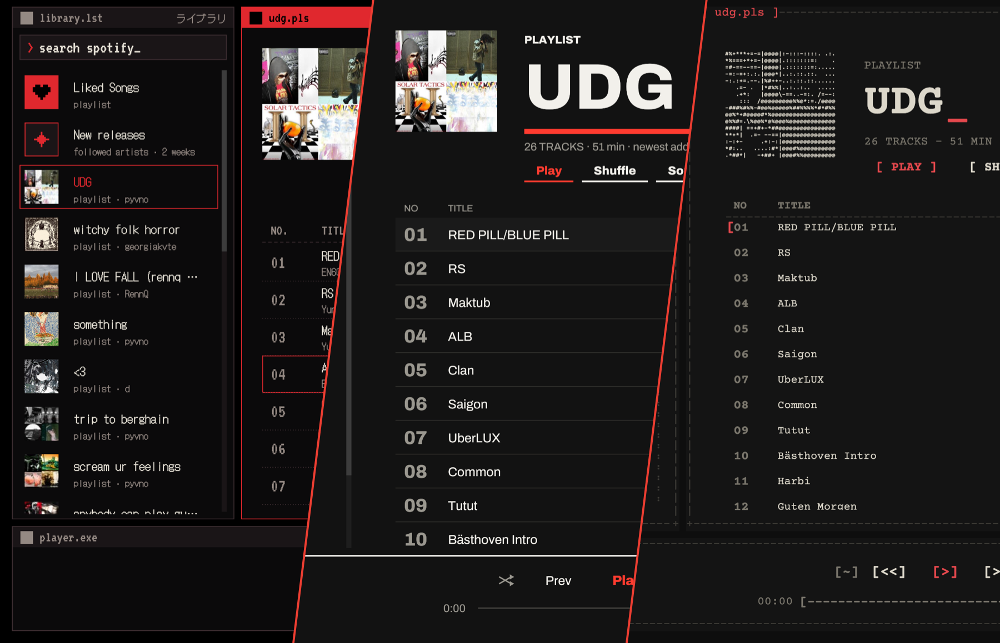

<div align="center">

# Resona

**A small native Spotify player for macOS, Linux and Windows.** Rust, [egui](https://github.com/emilk/egui) and
[librespot](https://github.com/librespot-org/librespot): no Electron, no web view.
Needs **Spotify Premium**.

[](https://github.com/pyvnoaim/resona/actions/workflows/build.yml)
[](https://github.com/pyvnoaim/resona/releases/latest)
[](LICENSE)


[Install](#install) · [Features](#features) · [Use](#use) · [Build from source](#build-from-source)



<sub>Wired · Swiss · ASCII</sub>

</div>

*Latin: resound!* Three skins, each with a dark and a light theme:

- **Wired**: cyber/pixel, black and red, in the spirit of *Serial Experiments Lain*. The default.
- **Swiss**: print grid, huge type, one red rule.
- **ASCII**: a teletype printout. Every frame, bar, heart and cover is drawn in plain characters, in Courier.

## Install

You need Spotify **Premium**: playback goes through librespot, which Spotify only allows for Premium accounts
(it doesn't work with free accounts). You also need a free Spotify developer app of your own (step 2).

### 1. Install Resona

| | how | you get |
|---|---|---|
| **macOS** 11+ (Apple silicon or Intel) | [one command](#macos) | `Resona.app` + `resona` in the terminal |
| **Linux** x86_64 (Ubuntu 24.04, Debian 13, Fedora 40 or newer) | [download and unpack](#linux) | `resona` |
| **Windows** 10/11 x64 | [download and unzip](#windows) | `resona.exe` |
| anything else | [build from source](#build-from-source) | |

#### macOS

Paste this into Terminal:

```sh
curl -fsSL https://raw.githubusercontent.com/pyvnoaim/resona/main/install.sh | sh
```

Resona is now in Applications and Spotlight, and `resona` in a terminal starts the terminal player. When a new
version is out, Resona offers it at launch: click Update and it installs it and reopens.

#### Linux

```sh
mkdir -p ~/.local/bin
curl -fsSL https://github.com/pyvnoaim/resona/releases/latest/download/resona-linux-x86_64.tar.gz | tar -xz -C ~/.local/bin
resona          # the window; `resona cli` for the terminal player
```

Older distributions can [build from source](#windows-and-linux). Needs ALSA and OpenSSL 3, which desktop
installs already have (otherwise: `sudo apt install libasound2t64 libssl3`). If `resona` isn't found, add
`~/.local/bin` to your `PATH`. When a new version is out, Resona offers it at launch: click Update and it replaces itself and reopens.

#### Windows

1. Download [`resona-windows-x86_64.zip`](https://github.com/pyvnoaim/resona/releases/latest/download/resona-windows-x86_64.zip)
   and unzip it anywhere, for example into `C:\Users\<you>\Apps\Resona`.
2. Double-click `resona.exe`. The build isn't signed, so SmartScreen may say "Windows protected your PC": click
   **More info**, then **Run anyway**. A console window opens next to Resona: leave it open, closing it quits
   Resona.

`resona.exe cli` in a terminal starts the terminal player. When a new version is out, Resona offers it at
launch: click Update and it replaces itself and reopens.

### 2. Make your Spotify developer app

Resona reads your library through a small app of your own on Spotify's developer site. Spotify limits apps in
development mode to their owner, so everyone makes their own. It's free and takes two minutes:

1. Go to [developer.spotify.com/dashboard](https://developer.spotify.com/dashboard), sign in with your Spotify
   account and accept the developer terms.
2. Click **Create app**. Any name and description will do (for example "Resona").
3. Under **Redirect URIs**, add exactly `http://127.0.0.1:8898/login` and click Add.
4. Under **Which API/SDKs are you planning to use?**, tick **Web API**. Accept the terms and click **Save**.
5. Open the app's **Settings** and copy its **Client ID**. You don't need the client secret.

### 3. First launch

Open Resona (on Linux and Windows: run `resona` / `resona.exe`). It asks for the client ID: paste it and click Connect. Your browser
then opens twice to sign in, once for playback and once for your app. After that Resona signs in by itself.

The terminal version asks for the client ID the same way: run `resona cli`.

## Features

- Liked Songs, your playlists, playlists you follow but don't own, artist and album pages
- New releases: songs from the last two weeks' releases by the artists you follow
- Song radio: similar songs to any song (right-click → Go to song radio)
- Search across Spotify
- Queue, shuffle, repeat
- Like and unlike songs, add songs to playlists or a new one (right-click, also on the playing song)
- Big cover view with synced lyrics; artist and album names open their pages
- Media keys, Now Playing, and a native menu bar with shortcuts (press `?` in the app for the full list)
- Six accent colours or your own hex colour (menu or ⌘,): hover a swatch to try it on the whole app, click to
  keep it. Your own colour is shaded per theme so it stays readable. The terminal version and the app icon follow it
- Remembers skin, theme, accent, volume and the last open list

## Use

Click a list on the left, then a song to play it. Right-click a song for the queue, likes,
playlists and song radio. Press `?` for every shortcut. Media keys and Control Center's Now Playing work too.

`resona cli` runs the same player full-screen in the terminal: arrows to move, tab to switch between your lists
and the songs, enter to play, `/` to search, `t` to switch between the two looks, `q` to quit. It does most of
what the window does: `a` / `A` queue a song or play it next, `p` adds it to a playlist, `v` shows the lyrics,
`i` starts a song radio, `g` / `G` open the artist / album, `c` copies the link, `m` mutes, and the queue shows in
the library while it has songs. Media keys and Now Playing work there too. Press `?` for every key.

## Files and signing in again

Everything Resona stores lives in `~/.resona/`. Delete `credentials.json` and `web_refresh_token` there to sign
in again (and `liked`, `following` and `lists/` too when switching Spotify accounts), and `client_id` to use another developer app. Setting
`RESONA_CLIENT_ID` overrides the saved ID.

## Build from source

Needs Xcode's command line tools and [Rust](https://rustup.rs):

```sh
xcode-select --install
curl --proto '=https' --tlsv1.2 -sSf https://sh.rustup.rs | sh

git clone https://github.com/pyvnoaim/resona.git
cd resona
./bundle.sh
```

`bundle.sh` builds the release version (a few minutes the first time), puts `Resona.app` into `/Applications`
and `resona` into `~/.local/bin`. To just run it: `cargo build --release && ./target/release/resona` (use the
release build: the debug build decodes audio too slowly).

## Windows and Linux

Resona runs there too (built and tested on every push), but it's only used day to day on macOS, so expect
rough edges. What's different:

- No menu bar: the same shortcuts use Ctrl instead of ⌘ (press `?` for the list).
- Media keys: Linux yes (MPRIS, so desktop media controls work); Windows not yet.
- No app bundle: a plain `resona` binary (Windows: `resona.exe`).

To build it yourself (with [Rust](https://rustup.rs)):

```sh
# Linux (Debian/Ubuntu) only: audio and TLS libraries
sudo apt install libasound2-dev libssl-dev pkg-config

cargo build --release
./target/release/resona          # Windows: target\release\resona.exe
```

Resona keeps its files in `~/.resona` (on Windows `C:\Users\<you>\.resona`).

## License

MIT, see [LICENSE](LICENSE). The bundled fonts (DotGothic16, VT323, Archivo, Courier Prime) are under the SIL
Open Font License; their licenses are in `assets/`.

Resona is not affiliated with Spotify.
